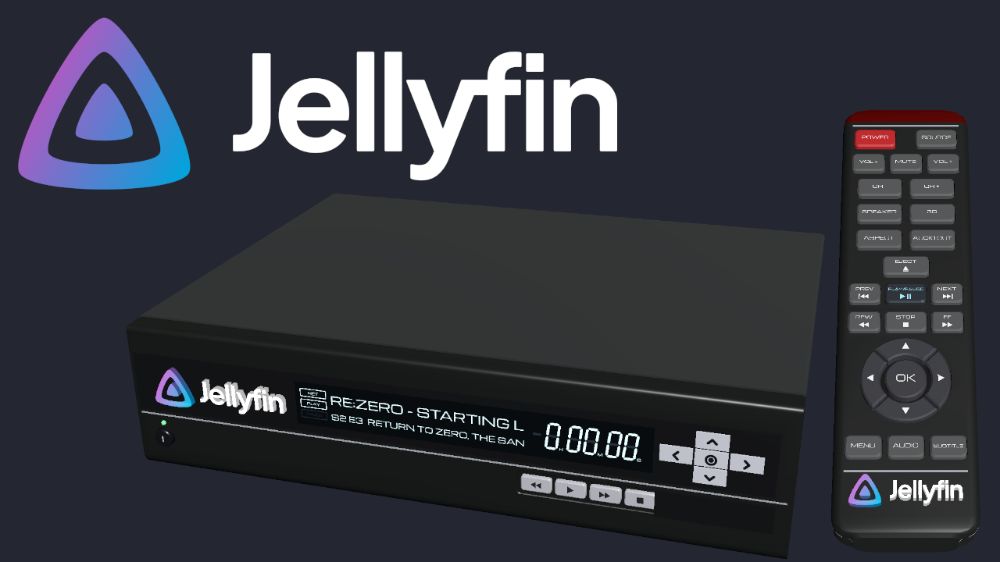
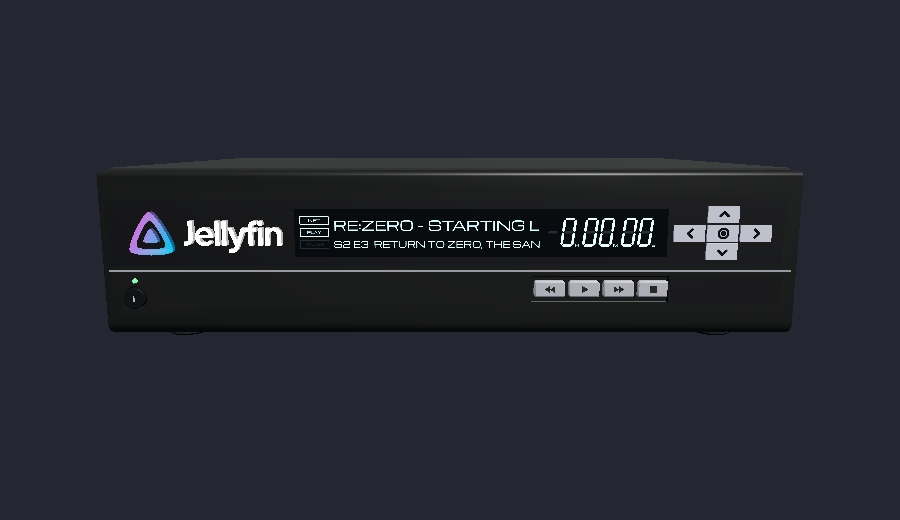
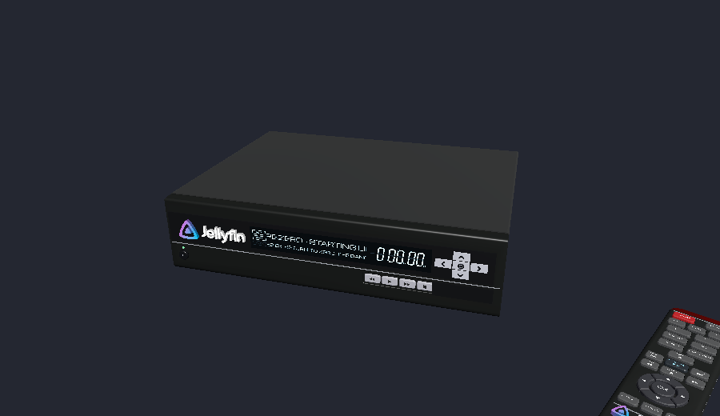

# Jellyfin Decoder (`xenu.jellyfin`)

A mod for [RetroXR](https://github.com/RetroXR/RetroXR): connect your Jellyfin server to your TV, the old-school way. The
Jellyfin Decoder is a VCR-style box that signs in to your server (Quick Connect, or user and password) and shows your whole
library on the TV as a Teletext page: recently added, what's next, continue watching, search, and every library. Pick a film
or episode and it plays on the TV, with audio and subtitle choices from the remote.

It needs a **Jellyfin server** you can reach from the room, and a RetroXR build with `RemoteTarget`.

## Screenshots





## Using it

Spawn the decoder from the Objects tab of the spawn menu, next to its remote ("Jellyfin Decoder Remote"). Cable its video and
audio sockets to a TV like a VCR and switch it on. Open its menu (point at it and press the left stick, or Tab on a computer),
type the server's address and sign in. Page 100 is the index.

The full guide, the server endpoints used and the technical notes are in [README.txt](README.txt).

## Development

```
python3 tests/run_all.py            # everything (needs Godot through the host, see CLAUDE.md)
python3 tools/pack_mod.py --out build/xenu.jellyfin-<version>.zip
```

Every push to `main` computes the next version from the commits (`feat` minor, `fix`/`perf` patch), publishes a GitHub
release and the same zip on mod.io.
